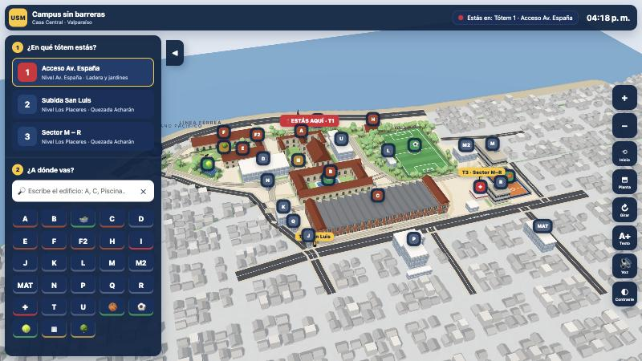
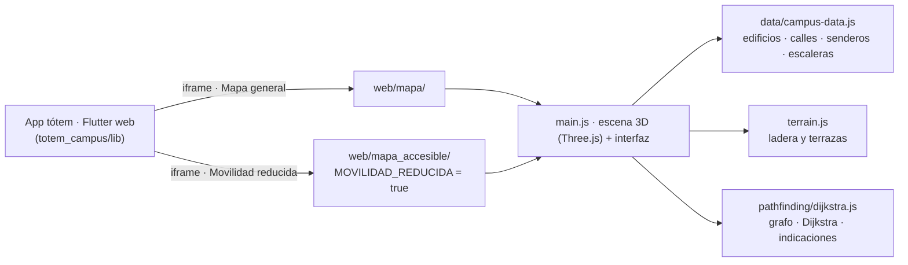
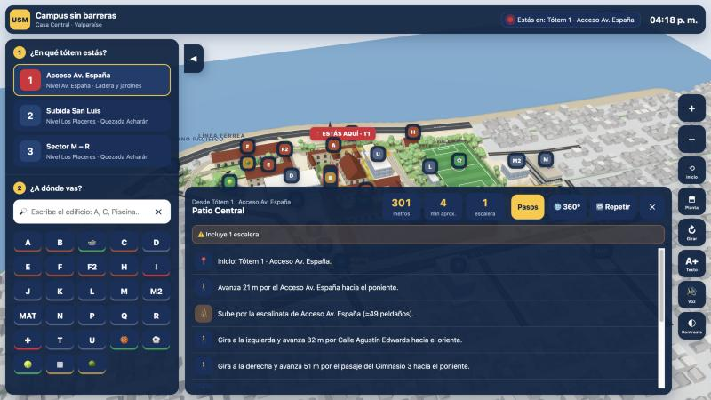
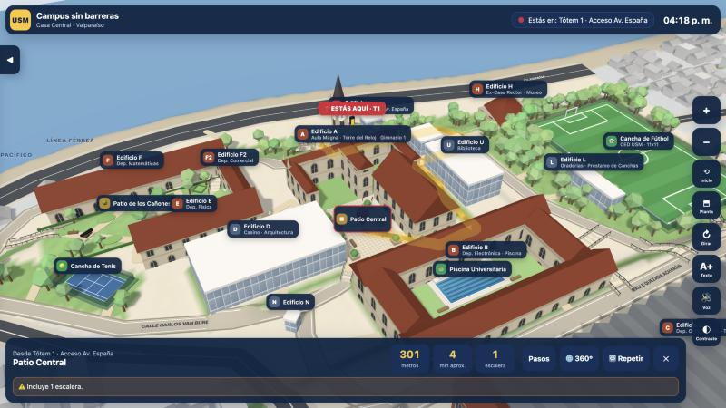
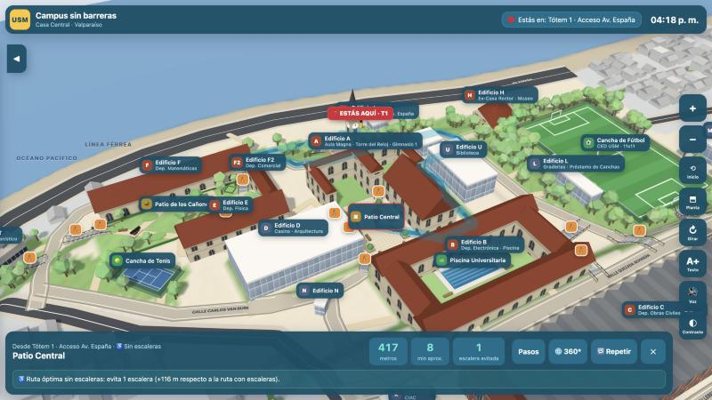
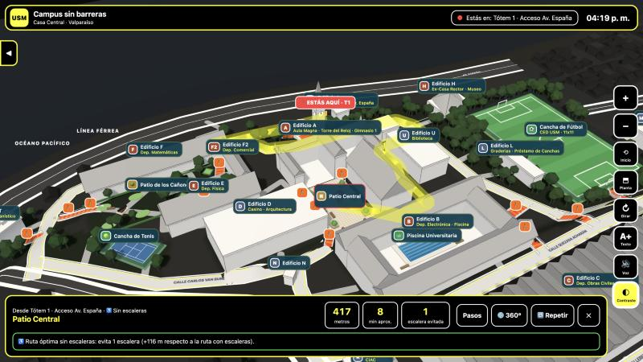

# AcceKIble · Tótem USM — Campus sin barreras

**Mapa 3D interactivo y orientación accesible para el Campus Casa Central de la UTFSM (Valparaíso).**
Un tótem táctil que muestra dónde estás, traza la mejor ruta hacia cualquier edificio y, en modo *Movilidad reducida*, calcula siempre el camino óptimo **sin escaleras**. Incluye guía por voz y alto contraste para personas con baja visión.

> Hackathon LYOSS USM 2026 · Desafío **“Campus sin barreras: movilidad y orientación para todos”**
> Equipo **Hijos de Jensen Huang** · Repositorio [`Hijos-de-Jensen-Huang-HACKATHON-LYOSS-AcceKIble`](https://github.com/Kynji64/Hijos-de-Jensen-Huang-HACKATHON-LYOSS-AcceKIble)



---

## Equipo

| Integrante |
|---|
| Tulio Barría |
| Vicente Vidal |
| Benjamin Arias |

---

## Problema y relación con el desafío / ODS

Casa Central está construida sobre la ladera de Valparaíso: entre **Av. España** (junto al mar) y **Av. Los Placeres** hay un fuerte desnivel repartido en terrazas, escalinatas monumentales, pasajes y patios interiores. Para orientarse hoy existe un plano impreso con letras de edificios, que:

- **No dice cómo llegar** ni cuánto se camina, y obliga a interpretar un plano dibujado “al revés” (con el sur arriba).
- **No distingue rutas con escaleras de rutas accesibles.** Para una persona en silla de ruedas, con muletas, una lesión temporal o un coche de bebé, elegir el camino equivocado significa devolverse y perder tiempo, o directamente no poder llegar.
- **No sirve para personas con baja visión o ceguera**: es solo visual, de letra pequeña y bajo contraste.
- Es especialmente difícil para **estudiantes de primer año, visitantes y estudiantes de intercambio**, que no conocen los nombres de calles internas ni de edificios.

**Dificultad concreta que abordamos:** encontrar y recorrer el camino hacia un edificio o espacio del campus cuando se tiene movilidad reducida, baja visión o no se conoce el campus.

**Estudiantes beneficiados:** personas con movilidad reducida (permanente o temporal), personas con baja visión o ceguera, y estudiantes nuevos o visitantes.

**Relación con los ODS:**

- **ODS 4 · Educación de calidad** (meta 4.a: instalaciones educativas accesibles para personas con discapacidad).
- **ODS 10 · Reducción de las desigualdades** (meta 10.2: inclusión de todas las personas, independiente de su discapacidad).
- **ODS 11 · Ciudades y comunidades sostenibles** (meta 11.7: acceso universal a espacios seguros, inclusivos y accesibles).

---

## Solución propuesta

Un **tótem táctil** ubicado en los tres accesos principales del campus (**T1 Acceso Av. España**, **T2 Subida San Luis** y **T3 Sector M–R**), con una app que reúne:

1. **Una maqueta 3D fiel del campus**, construida a partir del mapa de OpenStreetMap y del plano oficial de la USM, con el terreno en terrazas, las calles internas, los patios y las escaleras reales.
2. **Un motor de rutas** (grafo peatonal + Dijkstra) que traza el camino paso a paso desde el tótem hasta el destino.
3. **Dos modos de mapa** que se eligen con un botón grande:
   - **Mapa general:** la ruta más corta, avisando cuántas escaleras tiene.
   - **Movilidad reducida:** la ruta óptima **sin escaleras**, usando solo calles internas de pendiente continua y rampas, e indicando cuántas escaleras evitó y cuántos metros extra implica.
4. **Accesibilidad para baja visión:** guía por voz en español, modo alto contraste y botón de texto grande.

La app de tótem está hecha en **Flutter (web)** e incrusta el mapa 3D (HTML + JavaScript + Three.js) en un `iframe`; cada modo carga su propio mapa.



---

## Funcionalidades implementadas

**Orientación y rutas**
- Selector **“¿En qué tótem estás?”** con los 3 tótems y marcador **“Estás aquí”** animado en el mapa.
- **28 destinos**: edificios A a U, Edificio Matta, Edificio P (P1-P2), K - CIAC, Biblioteca (U), Casino (D), Museo (H), Sansanito, Piscina Universitaria, Patio Central, Patio de los Cañones, Cancha de Fútbol, Cancha Multiuso y Cancha de Tenis. Cada etiqueta indica los departamentos o servicios del edificio.
- **Búsqueda por texto** (“ciac”, “piscina”, “física”…) y grilla de botones grandes por letra.
- **Ruta animada** sobre el terreno, con distancia, tiempo estimado e **indicaciones paso a paso con dirección y giros**: *“Sube por la escalinata de Acceso Av. España (≈49 peldaños)”*, *“Gira a la derecha y avanza 92 m por Calle Carlos Van Buren hacia el sur”*.
- Red de rutas densa (684 nodos, 698 tramos) montada sobre las calles internas y senderos reales; cada tramo sabe si tiene escalera (`hasStairs`).

**Movilidad reducida (modo accesible)**
- Calcula siempre la **ruta óptima sin escaleras**: las 84 combinaciones tótem → destino tienen una ruta sin escalones.
- Muestra cuántas escaleras evita y cuántos metros extra suma respecto a la ruta más corta.
- Escaleras atenuadas y señalizadas con 🪜 en el mapa; ruta en color celeste.

**Accesibilidad para baja visión**
- **🔊 Guía por voz** (Web Speech API, español): anuncia el tótem, describe el edificio tocado y lee la ruta completa paso a paso; botón **🔁 Repetir**.
- **◐ Alto contraste** (diseñado con criterios WCAG AAA): interfaz negra con bordes amarillos/blancos y escena 3D oscura con edificios blancos y ruta amarilla gruesa.
- **A+ Texto grande**, botones táctiles grandes, foco visible y atributos ARIA (`aria-pressed`, `aria-label`).

**Maqueta 3D del campus**
- Casco histórico neogótico (A con Torre del Reloj y Aula Magna, B con su claustro y piscina, C Talleres con techo en diente de sierra, herradura E–F2–F) y edificios modernos diferenciados.
- Terreno en ladera con terrazas; **17 escaleras reales** (escalinata doble de Acceso Av. España, Patio Central, curva de Quezada Acharán, sectores M/R…) con pasamanos.
- Calles exteriores (asfalto oscuro) separadas de las calles internas del recinto, con sus nombres pintados en el pavimento; áreas verdes y entorno urbano.
- **Tour 360° USM** integrado: cada lugar sugiere sus escenas del recorrido virtual oficial.

**Modo tótem**
- Reinicio automático tras 2 minutos sin uso (limpia la ruta y apaga voz y contraste para la siguiente persona).
- Parámetros de URL para códigos QR: `?totem=T2&dest=K`.

| Indicaciones paso a paso | Ruta en el casco histórico |
|---|---|
|  |  |

| Movilidad reducida (sin escaleras) | Alto contraste |
|---|---|
|  |  |

---

## Tecnologías y dependencias

| Capa | Tecnología | Versión | Uso |
|---|---|---|---|
| App tótem | **Flutter** (web) / **Dart** | Flutter ≥ 3.47 (stable) · Dart ≥ 3.14 | Contenedor del tótem, selector de modo y panel de información |
| | `material_ui` | 1.11.1 | Componentes Material |
| | `web` | 1.1.2 | `HTMLIFrameElement` para incrustar el mapa |
| | `cupertino_icons` | 1.0.9 | Íconos |
| | `flutter_lints` (dev) | ^6.0.0 | Análisis estático |
| Mapa 3D | **JavaScript** (módulos ES), **HTML5**, **CSS3** | — | Interfaz y lógica del mapa |
| | **Three.js** (+ `OrbitControls`, `CSS2DRenderer`) | r160 (CDN jsDelivr) | Escena 3D, cámara y etiquetas |
| Rutas | Dijkstra con cola de prioridad (implementación propia) | — | `js/pathfinding/dijkstra.js` |
| APIs del navegador | **WebGL**, **Web Speech API** (`speechSynthesis`), `importmap` | — | Render 3D y guía por voz |
| Servicios externos | **Tour 360° USM** (iframe) | — | Vista previa de interiores y accesos |

El mapa **no necesita `npm install`**: Three.js se carga desde la CDN de jsDelivr con un `importmap`.

---

## Instalación y configuración

### 1. Requisitos (lo que hay que descargar)

| Herramienta | Para qué | Descarga |
|---|---|---|
| **Git** | Clonar el repositorio | https://git-scm.com/downloads |
| **Flutter SDK** ≥ 3.47 (canal stable, incluye Dart ≥ 3.14) | Ejecutar la app del tótem | https://docs.flutter.dev/get-started/install |
| **Google Chrome** (o Microsoft Edge) | Navegador donde corre la app | https://www.google.com/chrome/ |
| **Conexión a internet** | Three.js desde la CDN y Tour 360° | — |
| *Opcional:* **Python 3** | Servir solo los mapas, sin Flutter | https://www.python.org/downloads/ |

Comprueba la instalación de Flutter:

```bash
flutter --version
```
```bash
flutter doctor
```

`flutter doctor` debe mostrar **Chrome** como dispositivo disponible. Si Flutter dice que la web no está habilitada:

```bash
flutter config --enable-web
```

### 2. Clonar el repositorio

```bash
git clone https://github.com/Kynji64/Hijos-de-Jensen-Huang-HACKATHON-LYOSS-AcceKIble.git
```
```bash
cd Hijos-de-Jensen-Huang-HACKATHON-LYOSS-AcceKIble/totem_campus
```

### 3. Descargar las dependencias de Flutter

```bash
flutter pub get
```

No hay variables de entorno, claves de API ni bases de datos que configurar.

---

## Cómo ejecutar y probar la demo

### Opción A · App completa del tótem (Flutter)

Desde la carpeta `totem_campus`:

```bash
flutter run -d chrome
```

Se abre Chrome con la app del tótem. Si prefieres una URL fija (por ejemplo, para abrirla en otro navegador):

```bash
flutter run -d web-server --web-port 8080
```

y entra a **http://localhost:8080**.

Para generar la versión de producción (queda en `totem_campus/build/web`):

```bash
flutter build web --release
```

### Opción B · Solo los mapas 3D (sin instalar Flutter)

Los mapas son páginas estáticas. Se necesitan servir por HTTP, porque los módulos ES no cargan abriendo el archivo con doble clic (`file://`):

```bash
cd totem_campus/web
```
```bash
python3 -m http.server 8000
```

- Mapa general: **http://localhost:8000/mapa/**
- Mapa de movilidad reducida: **http://localhost:8000/mapa_accesible/**

### Recorrido sugerido para probar (2–3 minutos)

1. En **“¿En qué tótem estás?”** elige **T1 · Acceso Av. España**.
2. Escribe **“ciac”** en el buscador (o toca la letra **K**): se traza la ruta animada con distancia, tiempo y número de escaleras. Toca **Pasos** para ver las indicaciones.
3. Cambia al modo **Movilidad reducida** (botón grande del panel derecho) y pide el **Patio Central**: la ruta evita la escalinata y la tarjeta indica cuántas escaleras evitó y cuántos metros suma.
4. Toca **🔊 Voz** y luego cualquier edificio: escucharás su descripción y, al trazar una ruta, las indicaciones paso a paso.
5. Toca **◐ Contraste** para el modo de alto contraste y **A+** para agrandar el texto.
6. En la tarjeta de un edificio, toca **🌐 Ver interior y accesos en Tour 360° USM**.

---

## Estructura del repositorio

```text
├── README.md
├── LICENSE                         # GNU GPL v3.0
├── docs/img/                       # Capturas de la demo
└── totem_campus/                   # App del tótem (Flutter)
    ├── pubspec.yaml / pubspec.lock # Dependencias de Flutter
    ├── analysis_options.yaml
    ├── lib/
    │   ├── main.dart               # Layout del tótem, selector de modo e iframe del mapa
    │   └── panel_info.dart         # Panel derecho: avisos, servicios, preguntas y ayuda
    └── web/
        ├── index.html              # Entrada de la app Flutter web
        ├── mapa/                   # Mapa 3D general
        │   ├── index.html
        │   ├── css/styles.css
        │   └── js/
        │       ├── main.js                 # Escena Three.js, arquitectura, interfaz, voz y contraste
        │       ├── terrain.js              # Ladera Av. España → Los Placeres y terrazas
        │       ├── data/campus-data.js     # Edificios, calles, senderos, escaleras, tótems y áreas verdes
        │       └── pathfinding/dijkstra.js # Red de rutas, Dijkstra e indicaciones paso a paso
        └── mapa_accesible/         # Mismo mapa con MOVILIDAD_REDUCIDA = true (rutas sin escaleras)
```

Para editar el campus (posiciones, accesos, nuevas escaleras o rampas) basta con modificar `js/data/campus-data.js`: la red de rutas se regenera sola. Las coordenadas están en píxeles del mapa de referencia, con comentarios que explican cada campo.

---

## Recursos externos y atribuciones

- **OpenStreetMap** · © colaboradores de OpenStreetMap, datos bajo licencia [ODbL](https://www.openstreetmap.org/copyright). Se usó como referencia geométrica para ubicar edificios, calles y áreas verdes.
- **Plano oficial del Campus Casa Central (UTFSM)**, fotografiado en el campus: letras de edificios, calles internas, escaleras y espacios abiertos.
- **Tour 360° USM** · https://tour360.usm.cl/casa-central-valparaiso/ · contenido de la Universidad Técnica Federico Santa María, incrustado por `iframe`; se citan los nombres de sus escenas.
- **Three.js** · https://threejs.org · licencia MIT, cargado desde jsDelivr.
- **Flutter** · https://flutter.dev · licencia BSD-3-Clause.
- **Web Speech API** del navegador para la síntesis de voz (sin servicios externos de pago).
- Enunciado oficial de la **Hackathon LYOSS USM 2026**.

---

## Uso de herramientas de IA

Declaramos el uso de herramientas de IA generativa, según lo permiten las bases de la Hackathon:

- **Claude Code (Anthropic)** · Asistente de programación usado durante todo el desarrollo del **mapa 3D web**. Generó partes sustanciales del código en `totem_campus/web/mapa*`: la escena Three.js y la arquitectura de los edificios, el terreno en terrazas, el modelado de datos del campus a partir de los mapas y fotos que le entregamos, el grafo de rutas con Dijkstra y las indicaciones, las escaleras reales, la guía por voz, el modo alto contraste, la reparación del modo de movilidad reducida y la redacción base de este README.
- **Gemini (Google)** · Asistente de consulta y apoyo durante el desarrollo.

**Rol del equipo:** definimos el problema, los requisitos y las prioridades; aportamos las referencias (plano oficial fotografiado, mapas y ubicación de escaleras); desarrollamos la app Flutter del tótem; revisamos y corregimos las posiciones del campus, y probamos e integramos todas las partes. Todo el código generado fue revisado, probado en el navegador y ajustado por el equipo.

---

## Limitaciones conocidas

- **Precisión geográfica aproximada:** las posiciones vienen de OpenStreetMap y del plano oficial (margen estimado de 10–20 m). Las alturas de edificios y los desniveles entre terrazas son estimaciones.
- **Rampas y rutas accesibles por validar en terreno:** algunas rampas se modelaron como supuestos para que existiera una alternativa sin escaleras. Una implementación real requiere levantar en terreno pendientes, bordillos y rampas.
- **Sin interiores:** la navegación es exterior, entre accesos de edificios. Pisos y salas quedan para una fase 2 (los datos ya reservan `interior` por edificio).
- **La app Flutter es solo web:** usa `dart:ui_web` y un `iframe` para el mapa.
- **Requiere internet** para cargar Three.js y el Tour 360°; la voz depende de las voces instaladas en el navegador (se prefiere es-CL).
- El **Tour 360°** se abre en su vista general: el visor oficial no permite enlazar directamente una escena.

---

## Licencia

Distribuido bajo la licencia **GNU General Public License v3.0** (aprobada por la OSI). Ver [`LICENSE`](LICENSE).
Las dependencias usadas (Three.js · MIT, Flutter · BSD-3-Clause) son compatibles con la GPL v3.
